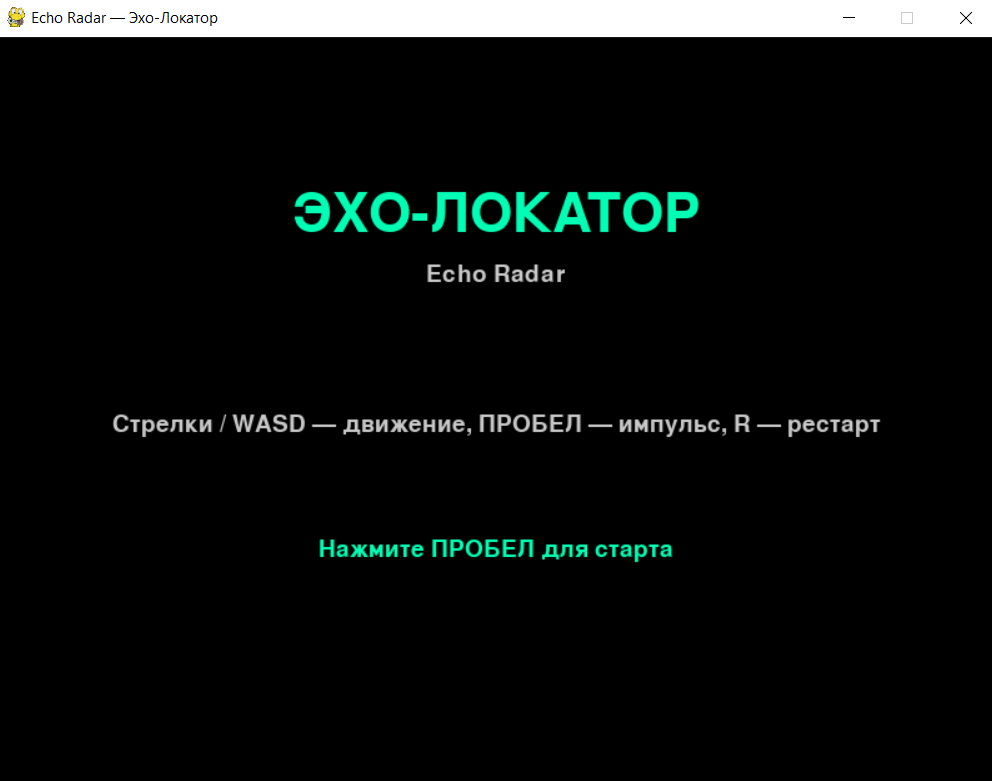
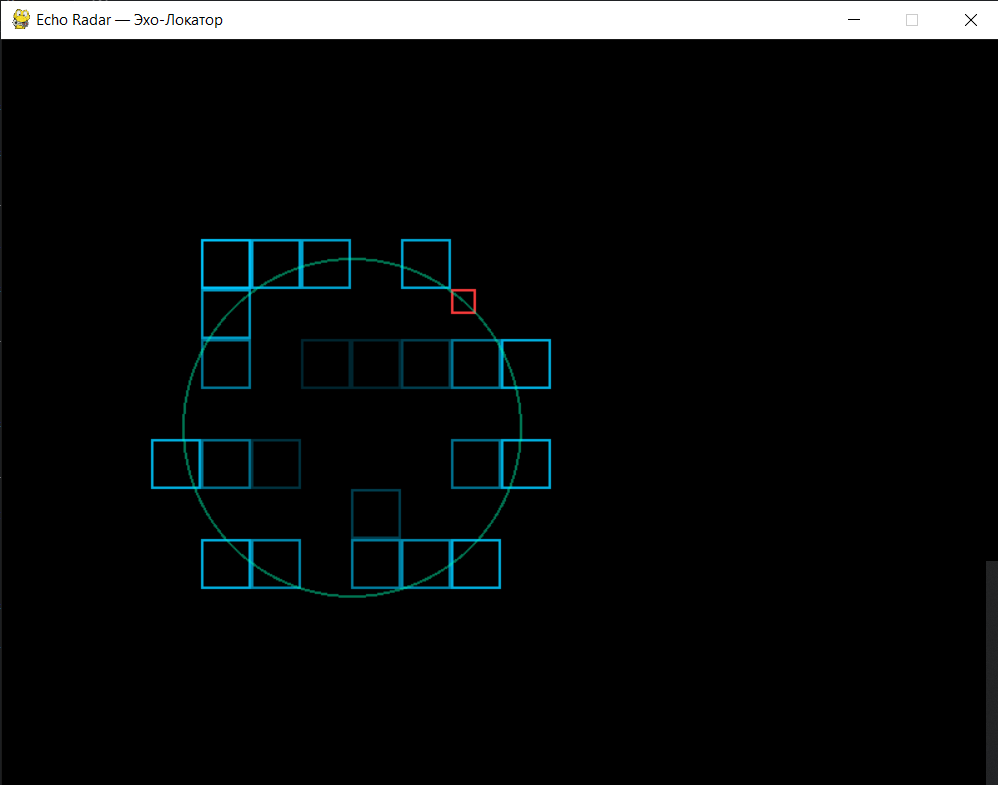
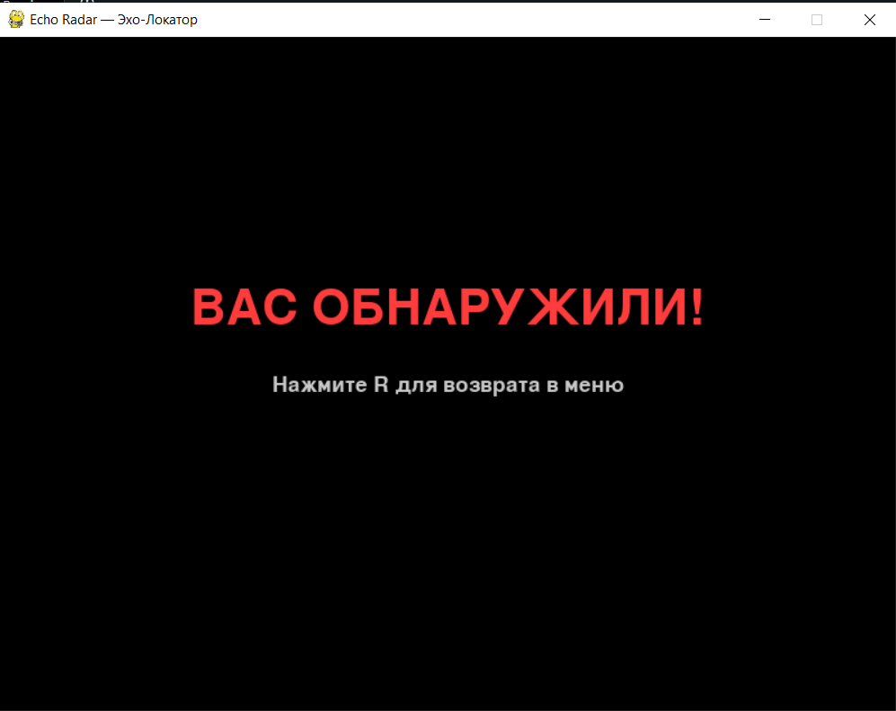
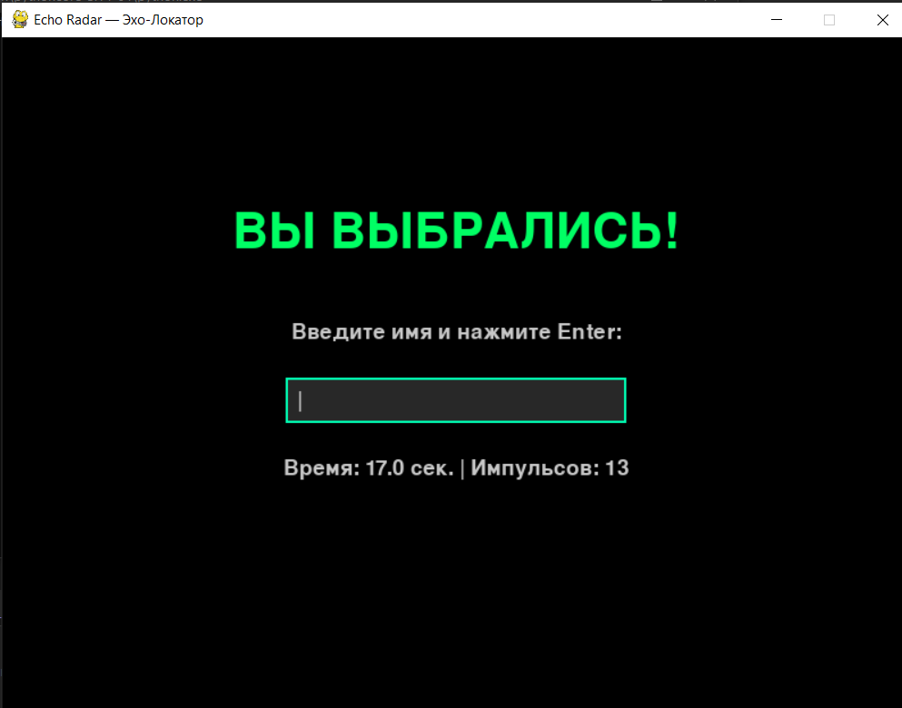

# ЭХО-ЛОКАТОР (Echo Radar) — Побег из тёмного лабиринта

2D стелс-игра с механикой эхолокации на Pygame. Экран полностью чёрный, игрок управляет невидимой точкой, которая ищет выход из лабиринта. Нажатие ПРОБЕЛА испускает звуковую волну, подсвечивающую контуры стен и врагов на пару секунд.

---

## Структура проекта
```
├── main.py            # Точка входа в приложение
├── constants.py       # Все константы: размеры, цвета, параметры
├── game.py            # Основной игровой цикл и состояния
├── level.py           # Построение и отрисовка стен
├── player.py          # Невидимый игрок
├── enemy.py           # Враги
├── sound_wave.py      # Класс звуковой волны
├── ui.py              # Интерфейс
│
├── map_loader.py      # Модуль загрузки JSON 
├── logger.py          # Модуль логирования в TXT и CSV 
│
├── radar_map.json     # Файл конфигурации уровня
├── radar_log.txt      # Лог прохождений (создаётся автоматически)
├── radar_records.csv  # Таблица рекордов (создаётся автоматически)
```

---

## Быстрый старт

**Установка зависимостей:**
```bash
pip install pygame
```

**Запуск:**
```bash
python main.py
```

**Управление:**
- `WASD` / `Стрелки` — перемещение невидимого игрока
- `ПРОБЕЛ` — испустить звуковую волну (эхо-импульс)
- `Enter` — подтвердить ввод имени после победы
- `R` — вернуться в меню после завершения игры

---

## Механики игры

1. **Невидимость.** Фон полностью чёрный. Игрок не отрисовывается, существует только как `pygame.Rect` для коллизий.
2. **Звуковой импульс.** При нажатии ПРОБЕЛА создаётся волна с радиусом `R = 0`, которая расширяется каждый кадр.
3. **Подсветка.** Если расстояние от центра волны до стены попадает в диапазон `R ± WAVE_THICKNESS`, стена получает `alpha = 255`.
4. **Затухание.** Яркость стен и врагов уменьшается на фиксированный шаг каждый кадр. Волна «дотлевает» 40 кадров после деактивации, чтобы всё успело погаснуть.
5. **Победа и поражение.** Выход за пределы экрана через проём = победа. Столкновение с врагом = поражение.

---

## Файлы данных

Работа с файлами инкапсулирована в модулях `map_loader.py` и `logger.py`. 

### 1. `radar_map.json` — конфигурация уровня
Файл содержит структуру лабиринта и параметры затухания волны. Загружается при старте игры через `map_loader.py`.

**Пример содержимого JSON-файла:**
```json
{
  "fade_speed": 8,
  "level": [
    [1, 1, 1, 1, 1, 1, 1, 1, 1, 1, 1, 1, 1, 1, 1, 1, 1, 1, 1, 1],
    [1, 0, 0, 0, 0, 0, 1, 0, 0, 0, 0, 0, 0, 0, 1, 0, 0, 0, 0, 1],
    [1, 0, 1, 1, 0, 0, 1, 0, 1, 1, 1, 1, 0, 0, 1, 0, 1, 1, 0, 1],
    [1, 0, 1, 0, 0, 0, 0, 0, 1, 0, 0, 1, 0, 0, 0, 0, 1, 0, 0, 1],
    [1, 0, 1, 0, 1, 1, 1, 0, 1, 0, 0, 1, 1, 1, 1, 0, 1, 0, 0, 1],
    [1, 0, 0, 0, 1, 0, 0, 0, 0, 0, 0, 0, 0, 0, 1, 0, 0, 0, 0, 1],
    [1, 1, 1, 0, 1, 0, 1, 1, 1, 1, 1, 1, 0, 1, 1, 0, 1, 1, 1, 1],
    [1, 0, 0, 0, 0, 0, 0, 0, 0, 0, 0, 0, 0, 1, 0, 0, 0, 0, 0, 1],
    [1, 0, 1, 1, 1, 1, 1, 1, 0, 1, 1, 1, 0, 1, 0, 1, 1, 1, 0, 1],
    [1, 0, 1, 0, 0, 0, 0, 1, 0, 0, 0, 1, 0, 0, 0, 1, 0, 0, 0, 1],
    [1, 0, 1, 0, 1, 1, 0, 1, 1, 1, 0, 1, 1, 1, 0, 1, 1, 0, 1, 1],
    [1, 0, 0, 0, 1, 0, 0, 0, 0, 0, 0, 0, 0, 0, 0, 0, 0, 0, 0, 1],
    [1, 1, 1, 0, 1, 1, 1, 1, 0, 1, 1, 0, 1, 1, 1, 1, 0, 1, 0, 1],
    [1, 0, 0, 0, 0, 0, 0, 1, 0, 0, 0, 0, 1, 0, 0, 0, 0, 1, 0, 1],
    [1, 1, 1, 1, 1, 1, 1, 1, 1, 1, 1, 1, 1, 1, 1, 1, 1, 1, 2, 1]
  ]
}
```
*   `level` — двумерный массив, где `1` — стена, `0` — пустота, `2` — финиш.
*   `fade_speed` — скорость затухания волны (сколько единиц яркости теряется за кадр).

> **Валидация:** при отсутствии файла или его повреждении (`FileNotFoundError`, `JSONDecodeError`, `KeyError`) игра не падает, а выводит предупреждение в консоль и загружает резервную карту, встроенную в `map_loader.py`.

### 2. `radar_log.txt` — лог прохождений
Текстовый файл, в который записывается результат **только при достижении финиша**. Имя игрока вводится прямо в окне Pygame (через состояние `STATE_ENTER_NAME`).

**Пример содержимого:**
```text
Игрок: Мария | Импульсов: 15 | Время: 13.3 сек.
Игрок: spammer | Импульсов: 79 | Время: 18.9 сек.
```

### 3. `radar_records.csv` — таблица рекордов
CSV-файл создаётся автоматически при первом сохранении результата. Заголовки добавляются только один раз. Удобен для открытия в Excel.

**Пример содержимого:**
```csv
Имя,Время (сек),Импульсов
Иван,45.3,12
Мария,30.7,8
```

---

## Скриншоты

### Стартовый экран


### Игровой процесс


### Проигрыш


### Ввод имени при побеге



---

## Технологии и зависимости

- **Python 3.12+**
- **Pygame 2.6+** (графический движок, ввод, таймеры)
- Стандартные библиотеки: `json`, `csv`, `pathlib`, `math`

Проверка версии Pygame:
```bash
python -c "import pygame; print(pygame.__version__)"
```
```
